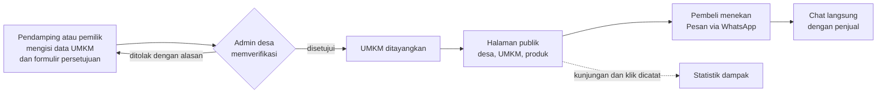
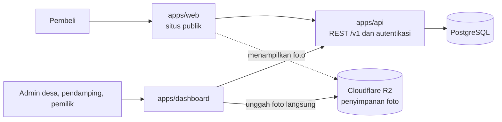

# Desanara

**Ragam Karya, Cerita Nusantara.**

Desanara adalah katalog produk UMKM multi-desa. Setiap desa punya halaman sendiri berisi cerita desa dan usaha warganya.
Pembeli menemukan produk khas sebuah desa, lalu memesan langsung ke pembuatnya lewat WhatsApp, tanpa perantara dan tanpa komisi.

Proyek ini dikembangkan oleh **HIMA Sistem Informasi, SATU University**, bersama program edukasi digital untuk pelaku
UMKM desa.

- Situs publik: https://desanara-web.vercel.app
- Dashboard pengelola: https://desanara-dashboard.vercel.app
- Instagram HIMASIF: [@himasif.su](https://www.instagram.com/himasif.su/)

Desa pilot pertama adalah **Desa Baros, Kecamatan Arjasari, Kabupaten Bandung, Jawa Barat**. Versi MVP dipresentasikan
pada seminar desa pilot tanggal **11 Desember 2026**. Selama pendataan berlangsung, UMKM dan produk yang tampil di situs
adalah data contoh.

## Daftar isi

1. [Latar belakang](#latar-belakang)
2. [Pengguna dan peran](#pengguna-dan-peran)
3. [Cara kerja](#cara-kerja)
4. [Fitur](#fitur)
5. [Arsitektur](#arsitektur)
6. [Teknologi](#teknologi)
7. [Keamanan dan privasi](#keamanan-dan-privasi)
8. [Menjalankan di komputer sendiri](#menjalankan-di-komputer-sendiri)
9. [Berkontribusi](#berkontribusi)
10. [Deploy](#deploy)
11. [Peta dokumentasi](#peta-dokumentasi)
12. [Tim dan kontak](#tim-dan-kontak)
13. [Lisensi](#lisensi)

## Latar belakang

Banyak UMKM desa membuat produk yang bagus, tetapi sulit dikenal di luar desanya. Kendalanya beragam: belum terbiasa
memotret produk, belum punya deskripsi dan harga yang jelas, belum memahami legalitas usaha, dan tidak sempat mengelola
toko di marketplace besar. Di sisi lain, wisatawan, pencari oleh-oleh, reseller, dan instansi yang mencari produk dari
desa tertentu tidak punya tempat untuk menemukannya.

Desanara menjawab dua sisi itu:

1. **Katalog yang berpusat pada desa.** Setiap produk tampil bersama asal desanya dan cerita pembuatnya. Pembeli
   menghubungi penjual langsung lewat WhatsApp, sehingga seluruh hasil penjualan diterima pelaku usaha.
2. **Pendampingan.** Mahasiswa HIMA mendampingi pelaku UMKM untuk memotret produk, menulis deskripsi, menentukan harga,
   memakai WhatsApp Business, dan mengurus legalitas (NIB lewat OSS, PIRT, halal _self-declare_).

Kepercayaan dijaga lewat verifikasi: setiap UMKM diperiksa oleh admin desanya sebelum boleh tampil.

Uraian masalah, persona, dan ukuran keberhasilan ada di [docs/product/vision.md](docs/product/vision.md).

## Pengguna dan peran

| Peran           | Siapa                               | Yang dilakukan                                                                          |
| --------------- | ----------------------------------- | --------------------------------------------------------------------------------------- |
| Pembeli         | Wisatawan, warga kota, reseller     | Menjelajah produk per desa dan kategori, lalu memesan lewat WhatsApp. Tidak perlu akun. |
| Pemilik UMKM    | Warga desa pemilik usaha            | Merawat data usaha dan produknya sendiri, atau dibantu pendamping.                      |
| Pendamping UMKM | Mahasiswa HIMA, peserta KKN         | Mengelola UMKM tertentu atas nama pemiliknya: data usaha, produk, dan foto.             |
| Pendamping desa | Mahasiswa yang ditugaskan di desa   | Mendaftarkan UMKM baru di desa tersebut.                                                |
| Admin desa      | Perangkat desa atau pengurus BUMDes | Memverifikasi UMKM, menayangkan atau menurunkan UMKM, mengatur tampilan dan tim desa.   |
| Super admin     | Pengurus HIMA                       | Mengelola desa, kategori, dan pengguna di seluruh platform.                             |

Satu akun bisa memegang beberapa peran sekaligus, misalnya pendamping di beberapa UMKM. Hak akses setiap peran dirinci
di [docs/architecture/auth-rbac.md](docs/architecture/auth-rbac.md).

## Cara kerja



1. Pendamping atau pemilik mengisi data UMKM di dashboard. Pemilik menandatangani formulir persetujuan publikasi data
   sesuai UU Pelindungan Data Pribadi sebelum datanya boleh tampil.
2. Admin desa memastikan usaha tersebut benar ada dan datanya sesuai, lalu menyetujui atau menolaknya dengan alasan.
3. UMKM yang sudah terverifikasi, punya persetujuan pemilik, dan punya nomor WhatsApp dapat ditayangkan.
4. Pembeli membuka halaman produk, memilih jumlah, menulis catatan, lalu menekan tombol pesan. WhatsApp terbuka dengan
   pesan yang sudah berisi nama produk, jumlah, dan catatannya. Pembayaran dan pengiriman disepakati langsung dengan penjual.
5. Setiap kunjungan halaman dan klik WhatsApp dicatat tanpa data pribadi pembeli, sebagai bahan laporan dampak per UMKM
   dan per desa.

Alur setiap peran dan perubahan status UMKM dijelaskan di [docs/product/user-flows.md](docs/product/user-flows.md).

## Fitur

Status per 16 November 2026. Feature freeze MVP: 28 November 2026.

### Situs publik

Tersedia dalam dua bahasa: Indonesia di `/` dan Inggris di `/en`.

| Halaman                    | Isi                                                                                                 | Status       |
| -------------------------- | --------------------------------------------------------------------------------------------------- | ------------ |
| Beranda `/`                | Pencarian, kategori, daftar desa, produk terbaru, cara memesan                                      | Selesai      |
| Jelajah `/jelajah`         | Pencarian produk, filter wilayah dan kategori, urutan, paginasi                                     | Selesai      |
| Desa `/desa/[desa]`        | Cerita desa dengan tampilan khas desa (warna, logo, huruf), daftar UMKM                             | Selesai      |
| UMKM `/desa/[desa]/[umkm]` | Cerita usaha, status buka atau tutup yang dihitung dari jam buka, tautan toko online, daftar produk | Selesai      |
| Produk `/produk/[produk]`  | Galeri foto, harga atau label Gratis, harga coret beserta persentase diskon, panel pesan WhatsApp   | Selesai      |
| Tentang `/tentang`         | Profil program dan kredit foto contoh                                                               | Selesai      |
| Pratinjau tautan           | Gambar pratinjau khusus per halaman saat tautan dibagikan di WhatsApp dan media sosial              | Direncanakan |

### Dashboard

Satu aplikasi untuk semua peran. Menu dan tombol menyesuaikan hak akses akun yang masuk, dan tampilannya dirancang untuk
dipakai di ponsel.

| Fitur                                                                                                       | Status                                   |
| ----------------------------------------------------------------------------------------------------------- | ---------------------------------------- |
| Masuk, pemeriksaan sesi, menu sesuai peran, beranda per peran                                               | Selesai                                  |
| Daftar UMKM dengan pencarian dan tab status                                                                 | Selesai                                  |
| Form UMKM tiga langkah; isian tersimpan otomatis di perangkat bila sinyal putus                             | Selesai                                  |
| Verifikasi UMKM, tayang dan sembunyikan dengan daftar syarat, turunkan dan pulihkan oleh admin desa         | Selesai                                  |
| Produk: harga rupiah, gratis, harga coret, satuan, kategori, terjemahan Inggris                             | API selesai, halaman sedang dikerjakan   |
| Foto: sampai 10 foto per produk, dikompres dan dibersihkan dari data lokasi di perangkat, urutan dan sampul | API selesai, halaman sedang dikerjakan   |
| Lokasi UMKM untuk keperluan internal (RT/RW, patokan, titik peta) dan data wilayah Kemendagri lengkap       | Direncanakan                             |
| Jam buka, tutup sementara, pengaturan desa, editor tampilan desa                                            | Direncanakan                             |
| Undangan dan serah-terima akun ke pemilik, pendaftaran UMKM lewat tautan desa, pengajuan desa baru          | Direncanakan                             |
| Statistik kunjungan dan klik WhatsApp                                                                       | Pencatatan selesai, halaman direncanakan |
| Kebijakan privasi serta syarat dan ketentuan                                                                | Direncanakan                             |

Daftar lengkap ada di [docs/product/features-mvp.md](docs/product/features-mvp.md), rencana jangka panjang di
[docs/product/roadmap.md](docs/product/roadmap.md), dan riwayat setiap perubahan di [docs/CHANGELOG.md](docs/CHANGELOG.md).

## Arsitektur



Repositori ini adalah monorepo berisi tiga aplikasi dan beberapa paket bersama. Prinsip yang dipegang:

- **Desa adalah tenant.** Setiap UMKM dan produk melekat pada satu desa. Setiap query dibatasi pada desa yang berhak
  mengaksesnya, dan data yang dihapus hanya ditandai (soft delete) sehingga masih bisa ditelusuri.
- **Frontend tidak pernah mengakses database.** Situs publik dan dashboard membaca dan menulis data hanya lewat API,
  memakai klien bertipe dari `packages/api-client`.
- **API berlapis.** Setiap modul terdiri dari `routes` (kontrak HTTP dan OpenAPI), `service` (aturan bisnis dan hak
  akses), dan `repository` (query database). Dokumentasi API dibuat otomatis dari kode.
- **Hak akses terpusat.** Semua keputusan "siapa boleh melakukan apa" ada di satu fungsi `can()` di `packages/auth`,
  dipakai oleh API dan dashboard, dan diuji untuk setiap aksi.
- **Situs publik dirender di server** agar cepat di ponsel, mudah ditemukan mesin pencari, dan tampil rapi saat
  tautannya dibagikan.
- **Foto tidak melewati API.** Dashboard meminta izin unggah sementara ke API, lalu mengunggah foto langsung ke
  penyimpanan. API hanya mencatat lokasi file.

### Struktur repositori

```text
apps/
  web/          situs publik dua bahasa
  dashboard/    aplikasi pengelola untuk semua peran
  api/          REST API /v1 dan autentikasi /api/auth
packages/
  db/           skema database, migrasi, data contoh
  auth/         aturan hak akses (can) dan konfigurasi autentikasi
  validators/   skema validasi yang dipakai bersama oleh API dan form
  api-client/   klien API bertipe
  ui/           token tema dan komponen dasar
  i18n/         bahasa, format rupiah, tautan WhatsApp
  config/       preset TypeScript dan ESLint
docs/           dokumentasi produk, arsitektur, keputusan teknis, panduan
```

### Data utama

| Kelompok         | Tabel                                                                                       |
| ---------------- | ------------------------------------------------------------------------------------------- |
| Wilayah dan desa | `regions` (kode Kemendagri), `villages`, `village_members`                                  |
| UMKM             | `businesses`, `business_members`, `invitations`                                             |
| Produk           | `products`, `product_translations`, `product_images`, `categories`, `category_translations` |
| Akun             | `users`, `sessions`, `accounts`, `verifications`                                            |
| Jejak            | `audit_logs` (perubahan penting), `analytics_events` (kunjungan dan klik)                   |

Penjelasan lebih lanjut: [overview](docs/architecture/overview.md), [multi-tenancy](docs/architecture/multi-tenancy.md),
[model data](docs/architecture/data-model.md), [konvensi API](docs/architecture/api-conventions.md).

## Teknologi

| Bagian         | Teknologi                                          | Alasan                                                                                                          |
| -------------- | -------------------------------------------------- | --------------------------------------------------------------------------------------------------------------- |
| Monorepo       | Turborepo 2, Bun 1.4                               | Satu repositori untuk semua aplikasi dan kode bersama ([ADR 0001](docs/adr/0001-turborepo-bun-monorepo.md))     |
| Frontend       | Next.js 16, React 19, HeroUI v3, Tailwind CSS v4   | Komponen aksesibel dan render di server ([ADR 0004](docs/adr/0004-heroui-v3-tailwind-v4.md))                    |
| Bahasa         | next-intl                                          | URL berbahasa Indonesia, versi Inggris di `/en` ([ADR 0008](docs/adr/0008-indonesian-url-segments.md))          |
| Data dashboard | TanStack Query                                     | Cache dan sinkronisasi data di sisi klien                                                                       |
| API            | Hono, zod-openapi, Zod 4                           | Ringan, bertipe dari ujung ke ujung, dokumentasi otomatis ([ADR 0002](docs/adr/0002-hono-backend.md))           |
| Autentikasi    | Better Auth                                        | Email dan kata sandi, sesi berbasis cookie                                                                      |
| Database       | PostgreSQL, Drizzle ORM                            | Postgres standar agar mudah dipindah ke server kampus ([ADR 0003](docs/adr/0003-supabase-as-plain-postgres.md)) |
| Penyimpanan    | Cloudflare R2                                      | Biaya rendah tanpa biaya transfer keluar ([storage](docs/architecture/storage.md))                              |
| Hosting        | Vercel (region Singapura), Supabase untuk Postgres | Deploy otomatis dan pratinjau per pull request ([ADR 0009](docs/adr/0009-api-on-vercel.md))                     |
| Pemesanan      | Tautan WhatsApp                                    | Sesuai kebiasaan pembeli dan penjual di desa ([ADR 0005](docs/adr/0005-whatsapp-checkout-mvp.md))               |

## Keamanan dan privasi

- **Alamat tidak pernah tampil di publik.** Halaman publik hanya menyebut desa, kecamatan, dan kabupaten. Alamat jalan,
  RT/RW, titik peta, dan NIB hanya bisa dilihat tim desa dan pendamping UMKM yang bersangkutan.
- **Persetujuan pemilik wajib.** UMKM tidak bisa tayang tanpa persetujuan tertulis pemiliknya. Persetujuan bisa ditarik
  kapan saja, dan UMKM langsung disembunyikan.
- **Hak akses diperiksa di server.** Tombol yang disembunyikan di dashboard hanya untuk kenyamanan; API tetap memeriksa
  setiap permintaan. Pengelola satu desa tidak dapat mengakses data desa lain.
- **Foto dibersihkan dari data lokasi.** Foto dari ponsel diproses ulang di perangkat sebelum diunggah, sehingga
  koordinat GPS yang tersimpan di dalam foto ikut terhapus.
- **Unggahan dibatasi.** Izin unggah berlaku singkat dan hanya untuk satu jenis serta ukuran file tertentu.
- **Perubahan penting tercatat.** Verifikasi, penayangan, penurunan, dan penghapusan disimpan di jejak audit.
- **Statistik tanpa data pribadi.** Pencatatan kunjungan tidak menyimpan alamat IP atau identitas pembeli.
- **Tidak ada rahasia di repositori.** Kunci dan kata sandi hanya disimpan di variabel lingkungan.

Penjelasan teknis: [docs/architecture/security-privacy.md](docs/architecture/security-privacy.md).

## Menjalankan di komputer sendiri

### Prasyarat

- [Bun](https://bun.sh) versi 1.4.2 atau lebih baru
- PostgreSQL 16 atau 17 (Docker, Postgres.app, atau ServBay)
- Git

### Langkah

```bash
git clone https://github.com/raflimaulanayh/desanara.id.git desanara
cd desanara
bun install
cp .env.example .env     # isi DATABASE_URL dan BETTER_AUTH_SECRET (buat dengan: openssl rand -base64 32)
bun run db:migrate       # membuat tabel
bun run db:seed          # data wilayah, kategori, dan data contoh
bun run dev              # menjalankan ketiga aplikasi
```

| Alamat                     | Aplikasi                              |
| -------------------------- | ------------------------------------- |
| http://localhost:3000      | Situs publik (versi Inggris di `/en`) |
| http://localhost:3001      | Dashboard                             |
| http://localhost:8787/docs | Dokumentasi API interaktif            |

Seed juga membuat akun contoh untuk setiap peran agar dashboard bisa dicoba di komputer sendiri. Penjelasannya ada di
[docs/guides/seed-data.md](docs/guides/seed-data.md).

### Variabel lingkungan

Semua variabel dijelaskan di [`.env.example`](.env.example). Ringkasnya:

| Variabel                                        | Fungsi                                                | Wajib di lokal  |
| ----------------------------------------------- | ----------------------------------------------------- | --------------- |
| `DATABASE_URL`                                  | Koneksi PostgreSQL                                    | Ya              |
| `BETTER_AUTH_SECRET`                            | Kunci penandatangan sesi login                        | Ya              |
| `TRUSTED_ORIGINS`                               | Asal yang boleh memanggil API dengan cookie           | Sudah ada nilai |
| `TEST_DATABASE_URL`                             | Database lokal khusus test integrasi                  | Untuk test      |
| `R2_*`, `NEXT_PUBLIC_MEDIA_URL`                 | Penyimpanan foto; tanpa ini fitur lain tetap berjalan | Tidak           |
| `SEED_WHATSAPP_NUMBER`, `SEED_DEMO_PASSWORD`    | Nomor WhatsApp dan kata sandi untuk data contoh       | Tidak           |
| `NEXT_PUBLIC_API_URL`, `NEXT_PUBLIC_WEB_URL`, … | Alamat antar aplikasi                                 | Sudah ada nilai |

### Perintah yang sering dipakai

```bash
bun run dev               # semua aplikasi (atau dev:web, dev:dashboard, dev:api)
bun run check:all         # format, lint, pemeriksaan tipe, dan test (sama dengan CI)
bun run db:generate       # membuat migrasi setelah mengubah skema di packages/db/src/schema
bun run db:migrate        # menjalankan migrasi
bun run db:seed           # mengisi ulang data contoh (aman diulang)
bun run db:seed:reset     # menghapus data contoh saja
bun run db:studio         # melihat isi database di browser
bun run generate          # membuat kerangka modul API baru
```

Panduan lengkap beserta solusi masalah umum: [docs/guides/local-setup.md](docs/guides/local-setup.md).

## Berkontribusi

1. **Diskusikan dulu.** Fitur besar atau yang menyentuh beberapa aplikasi ditulis sebagai rencana di
   `docs/plan/PLAN-<nama>.md` berdasarkan [template](docs/plan/TEMPLATE.md) dan disetujui sebelum dikerjakan.
2. **Buat branch dari `main`** dengan awalan jenis perubahan, misalnya `feat/product-pages` atau `fix/login-redirect`.
3. **Tulis commit** mengikuti [Conventional Commits](https://www.conventionalcommits.org), misalnya
   `feat(dashboard): add product form`. Formatnya diperiksa otomatis.
4. **Catat perubahan** di [docs/CHANGELOG.md](docs/CHANGELOG.md) dalam Bahasa Indonesia, entri terbaru di atas. CI
   menolak pull request tanpa entri.
5. **Ubah database hanya lewat migrasi Drizzle.** Jangan mengubah tabel langsung dari dashboard penyedia database.
6. **Buka pull request ke `main`.** CI memeriksa format, lint, tipe, test unit, dan test integrasi API dengan
   PostgreSQL. Setiap pull request mendapat pratinjau otomatis.
7. **Merge ke `main`** langsung men-deploy ketiga aplikasi.

Aturan lengkap untuk developer dan asisten AI ada di [AGENTS.md](AGENTS.md). Urutan membuat fitur dari database sampai
tampilan dijelaskan di [docs/guides/feature-end-to-end.md](docs/guides/feature-end-to-end.md).

## Deploy

Ketiga aplikasi berjalan sebagai project terpisah di Vercel (region Singapura) dan ter-deploy otomatis dari branch
`main`. Database memakai PostgreSQL terkelola di Supabase yang diakses sebagai Postgres biasa, sehingga bisa dipindah
ke server kampus tanpa mengubah kode. Foto disimpan di Cloudflare R2 milik HIMASIF. Sebagai cadangan, API juga bisa
dijalankan di VPS dengan Docker.

Langkah lengkap: [docs/guides/deploy.md](docs/guides/deploy.md). Detail teknis:
[docs/architecture/deployment.md](docs/architecture/deployment.md).

## Peta dokumentasi

| Tujuan                                          | Dokumen                                                                                                                                                       |
| ----------------------------------------------- | ------------------------------------------------------------------------------------------------------------------------------------------------------------- |
| Memahami produk tanpa membaca kode              | [Visi](docs/product/vision.md), [alur pengguna](docs/product/user-flows.md), [fitur MVP](docs/product/features-mvp.md), [glosarium](docs/product/glossary.md) |
| Memakai dashboard sebagai admin desa/pendamping | [Panduan dashboard](docs/guides/dashboard-user-guide.md)                                                                                                      |
| Mulai mengembangkan                             | [Onboarding developer](docs/guides/onboarding-dev.md), [setup lokal](docs/guides/local-setup.md), [AGENTS.md](AGENTS.md)                                      |
| Menilai rancangan teknis                        | [Arsitektur](docs/architecture/overview.md), [keamanan dan privasi](docs/architecture/security-privacy.md), [keputusan teknis (ADR)](docs/adr/README.md)      |
| Melihat riwayat perubahan                       | [CHANGELOG](docs/CHANGELOG.md)                                                                                                                                |

Indeks seluruh dokumen: [docs/README.md](docs/README.md).

## Tim dan kontak

Desanara dikembangkan oleh **HIMA Sistem Informasi (HIMASIF), SATU University**, dengan Desa Baros sebagai desa pilot.

- Instagram: [@himasif.su](https://www.instagram.com/himasif.su/)
- Pertanyaan atau kerja sama desa: hubungi HIMASIF lewat Instagram.
- Masalah teknis: buka [issue](https://github.com/raflimaulanayh/desanara.id/issues) di repositori ini.

Foto contoh di situs berasal dari sumber berlisensi terbuka; daftar penulisnya ada di halaman
[kredit foto](https://desanara-web.vercel.app/tentang/kredit-foto). Panduan identitas visual: [docs/brand/README.md](docs/brand/README.md).

## Lisensi

Kode sumber Desanara dirilis dengan [lisensi MIT](LICENSE), hak cipta 2026 HIMA Sistem Informasi, SATU University.
Kode boleh dipakai, diubah, dan dibagikan ulang, termasuk untuk keperluan komersial, selama teks lisensi dan
pemberitahuan hak cipta tetap disertakan.

Lisensi MIT **tidak** mencakup aset berikut. Aset ini tetap milik pemiliknya masing-masing dan tidak boleh dipakai di
luar proyek ini tanpa izin:

| Aset                                      | Lokasi                                                                              | Pemilik                                                                                                                                                    |
| ----------------------------------------- | ----------------------------------------------------------------------------------- | ---------------------------------------------------------------------------------------------------------------------------------------------------------- |
| Nama, logo, dan identitas visual Desanara | `docs/brand/`, `apps/*/public/brand/desanara-*`, ikon aplikasi di `apps/*/src/app/` | HIMA Sistem Informasi, SATU University                                                                                                                     |
| Logo HIMASIF dan SATU University          | `apps/web/public/brand/himasif.webp`, `apps/web/public/brand/satu-university.webp`  | HIMASIF dan SATU University                                                                                                                                |
| Logo dan foto Desa Baros                  | `apps/web/public/media/seed/villages/baros/`                                        | Pemerintah Desa Baros                                                                                                                                      |
| Foto contoh produk                        | `apps/web/public/media/seed/products/`                                              | Fotografer masing-masing, sesuai lisensi yang tercatat di file `.webp.json` dan halaman [kredit foto](https://desanara-web.vercel.app/tentang/kredit-foto) |

Proyek turunan wajib memakai nama dan logo sendiri.
