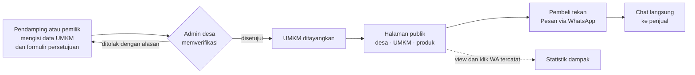
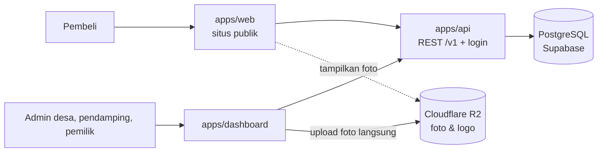

# Desanara

> **Ragam Karya, Cerita Nusantara.**
> Katalog produk UMKM multi-desa. Pembeli menemukan produk khas sebuah desa, lalu memesan langsung ke pembuatnya lewat WhatsApp.

Dibangun oleh **HIMA Sistem Informasi, SATU University**. Platform ini dipasangkan dengan program edukasi UMKM:
foto produk, deskripsi dan harga, WhatsApp Business, dan legalitas usaha.

|              |                                                                                     |
| ------------ | ----------------------------------------------------------------------------------- |
| Desa pilot   | **Desa Baros**, Kec. Arjasari, Kab. Bandung, Jawa Barat                             |
| Target MVP   | Seminar desa pilot **11 Desember 2026** (feature freeze 28 November 2026)           |
| Situs publik | https://desanara-web.vercel.app                                                     |
| Dashboard    | https://desanara-dashboard.vercel.app                                               |
| API          | https://desanara-api.vercel.app (`/health`; dokumentasi `/docs` dikunci kata sandi) |

> Semua UMKM dan produk yang tampil sekarang adalah **data contoh** (fiktif, ditandai `is_seed` di database).
> Data asli masuk setelah pendataan di desa pilot.

---

## Daftar isi

1. [Masalah yang diselesaikan](#masalah-yang-diselesaikan)
2. [Siapa penggunanya](#siapa-penggunanya)
3. [Cara kerja](#cara-kerja)
4. [Fitur dan status](#fitur-dan-status)
5. [Arsitektur dan teknologi](#arsitektur-dan-teknologi)
6. [Keamanan dan privasi data](#keamanan-dan-privasi-data)
7. [Menjalankan di laptop](#menjalankan-di-laptop)
8. [Alur kerja tim](#alur-kerja-tim)
9. [Peta dokumentasi](#peta-dokumentasi)

---

## Masalah yang diselesaikan

- UMKM desa sulit memperkenalkan produknya ke luar desa. Banyak yang belum siap secara digital: foto, deskripsi, harga, legalitas.
- Pembeli (wisatawan, pencari oleh-oleh, reseller, pemda/CSR) sulit menemukan produk khas dari desa tertentu.
- Marketplace besar memotong komisi dan tidak menceritakan asal-usul produk.

Desanara menampilkan **setiap produk sebagai bagian dari desanya**. Pembeli bicara langsung dengan pembuatnya, tanpa perantara
dan tanpa komisi. Setiap UMKM **diverifikasi oleh admin desanya** dan didampingi mahasiswa HIMA.

Selengkapnya: [docs/product/vision.md](docs/product/vision.md).

## Siapa penggunanya

| Peran                      | Siapa                           | Yang dilakukan di Desanara                                                       |
| -------------------------- | ------------------------------- | -------------------------------------------------------------------------------- |
| **Pembeli**                | Wisatawan, warga kota, reseller | Menjelajah produk per desa/kategori, pesan lewat WhatsApp. Tidak perlu akun.     |
| **Pemilik UMKM**           | Warga desa pemilik usaha        | Merawat data usaha dan produknya (bisa dibantu pendamping).                      |
| **Pendamping UMKM / desa** | Mahasiswa HIMA, peserta KKN     | Mendaftarkan UMKM baru, memotret dan menginput produk atas nama pemilik.         |
| **Admin desa**             | Perangkat desa / BUMDes         | Memverifikasi UMKM desanya, menayangkan atau menurunkan, mengatur tampilan desa. |
| **Super admin**            | Pengurus HIMA                   | Mengelola desa, kategori, dan pengguna di seluruh platform.                      |

Satu orang bisa punya beberapa peran, misalnya pendamping di dua UMKM sekaligus.

## Cara kerja



1. Pendamping (atau pemilik) mengisi data UMKM di dashboard. Pemilik menandatangani **formulir persetujuan** (UU PDP) sebelum data boleh tampil.
2. Admin desa memeriksa bahwa usaha itu benar ada, lalu **Setujui** atau **Tolak** dengan alasan.
3. UMKM yang terverifikasi, punya persetujuan, dan punya nomor WhatsApp bisa **ditayangkan**.
4. Pembeli membuka halaman desa, UMKM, atau produk, lalu menekan **Pesan via WhatsApp**. Pesannya sudah terisi nama produk, jumlah, dan catatan.
5. Setiap kunjungan dan klik WhatsApp dicatat untuk laporan dampak per UMKM dan per desa.

Alur lengkap per peran, status UMKM, dan contoh layar: [docs/product/user-flows.md](docs/product/user-flows.md).
Panduan memakai dashboard untuk admin desa dan pendamping: [docs/guides/dashboard-user-guide.md](docs/guides/dashboard-user-guide.md).

## Fitur dan status

✅ selesai · 🚧 sebagian · ⏳ belum

| Area         | Fitur                                                                                                                            | Status                                |
| ------------ | -------------------------------------------------------------------------------------------------------------------------------- | ------------------------------------- |
| Situs publik | Beranda, jelajah (pencarian, filter wilayah/kategori, urutan), halaman desa bertema, halaman UMKM dan produk, dua bahasa (ID/EN) | ✅                                    |
| Situs publik | Pesan via WhatsApp (jumlah + catatan), status buka/tutup otomatis dari jam buka, slider foto, harga gratis dan harga coret       | ✅                                    |
| Dashboard    | Login, menu sesuai peran, beranda per peran                                                                                      | ✅                                    |
| Dashboard    | UMKM: daftar + pencarian, form 3 langkah dengan draf otomatis, verifikasi, tayang/sembunyikan, turunkan/pulihkan                 | ✅                                    |
| Dashboard    | Produk: daftar, form, upload sampai 10 foto + urutan, logo UMKM                                                                  | 🚧 API selesai, halaman sedang dibuat |
| Dashboard    | Lokasi UMKM (RT/RW, titik peta), data wilayah Kemendagri lengkap, pengaturan desa, jam buka                                      | ⏳                                    |
| Dashboard    | Antrean verifikasi, undangan dan serah-terima akun ke pemilik, pendaftaran UMKM mandiri, ajukan desa baru                        | ⏳                                    |
| Dampak       | Pencatatan view dan klik WhatsApp                                                                                                | ✅                                    |
| Dampak       | Halaman statistik                                                                                                                | ⏳                                    |
| Legal        | Kebijakan privasi, syarat dan ketentuan                                                                                          | ⏳                                    |
| Nanti        | Aplikasi yang bisa dipasang di HP (PWA) + notifikasi                                                                             | ⏳ setelah MVP inti                   |

Daftar lengkap: [docs/product/features-mvp.md](docs/product/features-mvp.md) · Rencana jangka panjang: [docs/product/roadmap.md](docs/product/roadmap.md) · Riwayat perubahan: [docs/CHANGELOG.md](docs/CHANGELOG.md).

## Arsitektur dan teknologi



Tiga aplikasi dalam satu repo (monorepo). **Desa adalah tenant**: semua data UMKM dan produk melekat pada satu desa,
dan setiap query dibatasi ke desa yang berhak.

| Lapisan      | Teknologi                                         | Kenapa                                                                                                                                                                    |
| ------------ | ------------------------------------------------- | ------------------------------------------------------------------------------------------------------------------------------------------------------------------------- |
| Monorepo     | Turborepo + Bun                                   | Satu repo untuk web, dashboard, API, dan kode bersama ([ADR 0001](docs/adr/0001-turborepo-bun-monorepo.md))                                                               |
| Situs publik | Next.js 16, HeroUI v3, Tailwind CSS v4, next-intl | Render di server untuk SEO dan pratinjau link WhatsApp; dua bahasa ([ADR 0004](docs/adr/0004-heroui-v3-tailwind-v4.md), [0008](docs/adr/0008-indonesian-url-segments.md)) |
| Dashboard    | Next.js 16, HeroUI v3, TanStack Query             | Aplikasi interaktif untuk HP murah; satu dashboard untuk semua peran                                                                                                      |
| API          | Hono + OpenAPI (zod-openapi), Better Auth         | Ringan, bertipe end-to-end, dokumentasi API otomatis ([ADR 0002](docs/adr/0002-hono-backend.md))                                                                          |
| Database     | PostgreSQL di Supabase, Drizzle ORM               | Supabase dipakai **hanya sebagai Postgres biasa** agar bisa pindah ke VPS kampus ([ADR 0003](docs/adr/0003-supabase-as-plain-postgres.md))                                |
| File         | Cloudflare R2 (akun HIMASIF)                      | Murah, tanpa biaya egress; foto diunggah langsung dari browser ([storage](docs/architecture/storage.md))                                                                  |
| Hosting      | Vercel (3 project, region Singapura)              | Deploy otomatis dari `main`, preview per PR ([ADR 0009](docs/adr/0009-api-on-vercel.md))                                                                                  |
| Pemesanan    | Link WhatsApp                                     | Pembayaran dan pengiriman di luar platform untuk MVP ([ADR 0005](docs/adr/0005-whatsapp-checkout-mvp.md))                                                                 |

### Struktur repo

```text
apps/
  web/          situs publik (/, /jelajah, /desa/[desa], /desa/[desa]/[umkm], /produk/[produk]; /en untuk Inggris)
  dashboard/    aplikasi login untuk semua peran (/login, /businesses, …)
  api/          REST API /v1 + Better Auth /api/auth/* (modul: routes → service → repository)
packages/
  db/           skema Drizzle, migrasi, seed data contoh
  auth/         can() / assertCan(): satu-satunya tempat aturan hak akses
  validators/   skema Zod yang dipakai API dan form dashboard
  api-client/   klien API bertipe untuk web dan dashboard
  ui/           token tema HeroUI dan komponen netral
  i18n/         bahasa, format rupiah, link WhatsApp
  config/       preset TypeScript dan ESLint
docs/           produk, arsitektur, ADR, panduan, rencana, CHANGELOG
```

Penjelasan lengkap: [docs/architecture/overview.md](docs/architecture/overview.md).

## Keamanan dan privasi data

- **Hak akses terpusat.** Semua keputusan "siapa boleh apa" ada di satu fungsi `can()` ([`packages/auth/src/permissions.ts`](packages/auth/src/permissions.ts)), lengkap dengan test, dan dicek di setiap endpoint API.
- **Isolasi antar desa.** Admin desa A tidak bisa melihat atau mengubah UMKM desa B. Aturan ini diuji.
- **Alamat tidak pernah tampil publik.** Halaman publik hanya menampilkan desa, kecamatan, dan kabupaten, seperti marketplace yang hanya menampilkan kota penjual.
- **Persetujuan pemilik (UU PDP)** wajib ada sebelum UMKM tayang, dan bisa ditarik kapan saja (UMKM langsung disembunyikan).
- **Foto dibersihkan dari lokasi GPS.** Foto dari HP disimpan ulang di browser sebelum diunggah, sehingga data EXIF (termasuk koordinat rumah) hilang.
- **Upload terkunci.** Link upload hanya berlaku 5 menit, untuk satu ukuran dan satu jenis file.
- **Jejak audit.** Verifikasi, penayangan, penurunan, dan penghapusan dicatat di `audit_logs`.
- **Tanpa rahasia di repo.** Kunci dan kata sandi hanya ada di `.env` lokal dan pengaturan Vercel.

Detail teknis dan celah yang masih direncanakan: [docs/architecture/security-privacy.md](docs/architecture/security-privacy.md).

## Menjalankan di laptop

Prasyarat: [Bun](https://bun.sh) ≥ 1.4.2, PostgreSQL 16/17 lokal (Docker, Postgres.app, atau ServBay), Git.

```bash
git clone https://github.com/raflimaulanayh/desanara.id.git desanara && cd desanara
bun install
cp .env.example .env          # isi minimal DATABASE_URL dan BETTER_AUTH_SECRET (openssl rand -base64 32)
bun run db:migrate            # buat tabel
bun run db:seed               # data wilayah, kategori, dan data contoh
bun run dev                   # web :3000 · dashboard :3001 · api :8787
```

| Buka                        | Isi                                    |
| --------------------------- | -------------------------------------- |
| http://localhost:3000       | Situs publik (bahasa Inggris di `/en`) |
| http://localhost:3001/login | Dashboard                              |
| http://localhost:8787/docs  | Dokumentasi API interaktif             |

**Akun contoh di laptop** (kata sandi `demo12345`, atau isi `SEED_DEMO_PASSWORD` di `.env`):

| Email                                       | Peran                          |
| ------------------------------------------- | ------------------------------ |
| `superadmin@demo.desanara.test`             | Super admin                    |
| `admin.baros@demo.desanara.test`            | Admin Desa Baros               |
| `pendamping.baros@demo.desanara.test`       | Pendamping Desa Baros + 4 UMKM |
| `pemilik.keripik-bu-ani@demo.desanara.test` | Pemilik UMKM Keripik Bu Ani    |

Akun yang sama ada di dashboard production dengan kata sandi berbeda. Minta ke pengurus tim.

Upload foto butuh variabel R2 di `.env` (lihat `.env.example`). Tanpa itu, fitur lain tetap jalan dan upload menjawab "layanan tidak tersedia".

Panduan lengkap dan solusi masalah umum: [docs/guides/local-setup.md](docs/guides/local-setup.md) · Isi data contoh: [docs/guides/seed-data.md](docs/guides/seed-data.md).

### Perintah penting

```bash
bun run dev                    # semua aplikasi (atau dev:web / dev:dashboard / dev:api)
bun run check:all              # format + lint + cek tipe + test (sama dengan CI)
bun run db:generate            # buat migrasi setelah mengubah packages/db/src/schema
bun run db:migrate             # jalankan migrasi
bun run db:seed                # isi ulang data contoh (aman diulang)
bun run db:seed:reset          # hapus data contoh saja
bun run db:studio              # lihat isi database di browser
bun run generate               # scaffold modul API baru
```

## Alur kerja tim

1. **Diskusikan dulu.** Fitur besar atau lintas aplikasi ditulis sebagai rencana di `docs/plan/PLAN-<nama>.md` ([template](docs/plan/TEMPLATE.md)) dan disetujui sebelum dikerjakan.
2. **Branch dari `main`**: `feat/…`, `fix/…`, `docs/…`, misalnya `feat/product-pages`.
3. **Commit** pakai [Conventional Commits](https://www.conventionalcommits.org): `feat(dashboard): add product form`. Dicek otomatis oleh commitlint.
4. **Setiap perubahan dicatat** di [docs/CHANGELOG.md](docs/CHANGELOG.md) (Bahasa Indonesia, terbaru di atas). CI menolak PR tanpa entri.
5. **Perubahan database hanya lewat migrasi Drizzle**, tidak pernah lewat dashboard Supabase. Migrasi ke production dijalankan sebelum merge.
6. **Buka PR ke `main`.** CI harus hijau: format, lint, tipe, test unit, dan test integrasi API dengan Postgres. Vercel membuat preview untuk setiap PR.
7. **Merge ke `main`** langsung men-deploy ketiga aplikasi ke production.

Aturan lengkap untuk developer dan AI agent: [AGENTS.md](AGENTS.md) · Cara membuat fitur dari database sampai layar: [docs/guides/feature-end-to-end.md](docs/guides/feature-end-to-end.md).

## Peta dokumentasi

| Saya ingin…                                | Baca                                                                                                                                                             |
| ------------------------------------------ | ---------------------------------------------------------------------------------------------------------------------------------------------------------------- |
| Paham produknya tanpa membaca kode         | [Visi](docs/product/vision.md) → [Alur pengguna](docs/product/user-flows.md) → [Fitur MVP](docs/product/features-mvp.md) → [Glosarium](docs/product/glossary.md) |
| Memakai dashboard (admin desa, pendamping) | [Panduan dashboard](docs/guides/dashboard-user-guide.md)                                                                                                         |
| Mulai ngoding                              | [Onboarding developer](docs/guides/onboarding-dev.md) → [Setup lokal](docs/guides/local-setup.md) → [AGENTS.md](AGENTS.md)                                       |
| Menilai rancangan teknis                   | [Arsitektur](docs/architecture/overview.md) → [Keamanan & privasi](docs/architecture/security-privacy.md) → [ADR](docs/adr/README.md)                            |
| Deploy atau ganti domain                   | [Panduan deploy](docs/guides/deploy.md) · [Deployment](docs/architecture/deployment.md)                                                                          |
| Tahu apa yang berubah                      | [CHANGELOG](docs/CHANGELOG.md)                                                                                                                                   |

Indeks semua dokumen: [docs/README.md](docs/README.md).

## Kredit

Desanara dikembangkan oleh **HIMA Sistem Informasi, SATU University**, dengan Desa Baros sebagai desa pilot.
Foto contoh berasal dari sumber berlisensi terbuka; daftar penulisnya ada di halaman
[/tentang/kredit-foto](https://desanara-web.vercel.app/tentang/kredit-foto). Panduan brand: [docs/brand/README.md](docs/brand/README.md).
