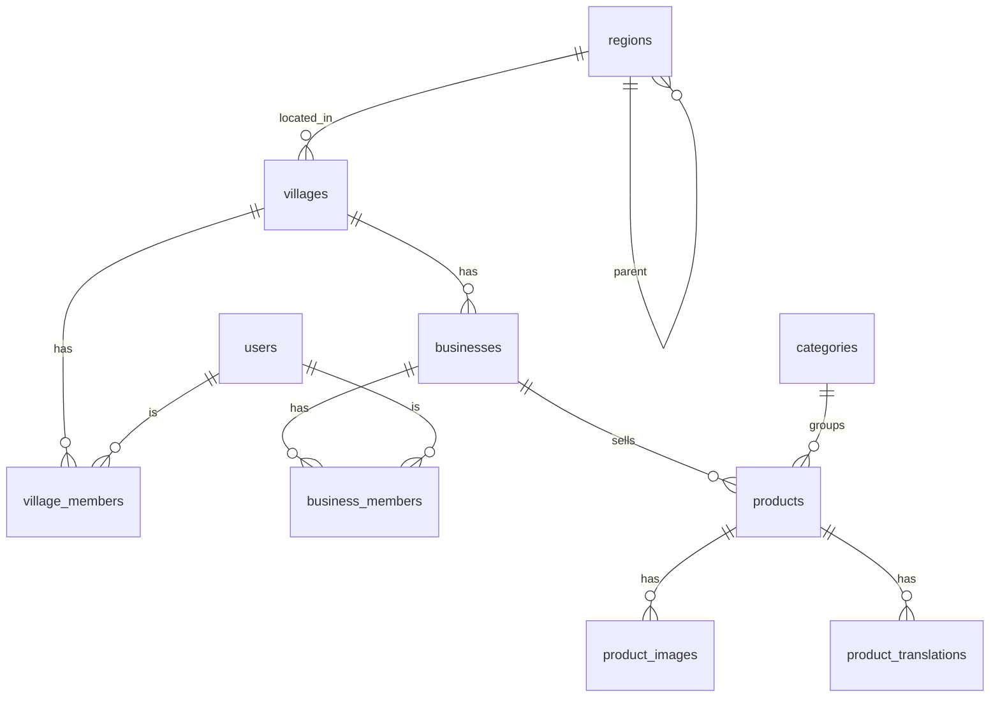

# Data model

Source of truth: `packages/db/src/schema/*`. Migrations: `packages/db/drizzle/`. This page explains intent.

## Conventions

- Ids: `uuid` (random) for domain tables; Better Auth tables use text ids.
- `createdAt` / `updatedAt` everywhere; `deletedAt` (soft delete) on villages, businesses, products.
- `isSeed` on rows created by the demo seed; `db:seed:reset` deletes only those.
- Money: `products.price` is an integer in rupiah.
- Status: `record_status` = draft | published | archived. Businesses also have
  `verification_status` = pending | verified | rejected (verified once by the village admin).
- `businesses.consentAt` records UU PDP consent; required before publishing. `consentMethod`
  (`paper_form` | `in_app`) and `consentRecordedBy` say how it was obtained and by whom, so consent can be
  proven later. Staff record `paper_form` from the signed form; the owner confirms `in_app` at hand-over.
- `businesses.verificationNote` holds the reason of the last review decision.
- `businesses.takenDownAt` / `takenDownBy` / `takedownReason`: a village admin's takedown. Public queries
  exclude taken-down businesses (`publicBusiness` in `apps/api/src/lib/visibility.ts`).
- Business slugs are generated from the name by the API (`toSlug()` in `@repo/validators`, `-2`, `-3` … on
  duplicates) and only village admins may change them (it breaks shared links).
- `villages.theme` / `theme_draft` (JSONB) hold per-village branding; shape and rules in
- `businesses.openingHours` (JSONB, `OpeningHours` in `@repo/validators`), `closedUntil`, `closedNote` drive the
  open/closed status, computed with `computeOpenStatus()` in the village time zone (`villages.timezone`,
  default `Asia/Jakarta`). No schedule = no status shown.
  [village-theming.md](village-theming.md). Always read with `parseVillageTheme()`.
- Translations: Indonesian is the base column; optional rows in `*_translations` (`locale = 'en'`) override it.
  Read with a fallback to the base column.

## Regions

`regions.code` uses Kemendagri codes: `32` → `32.04` → `32.04.10` → `32.04.10.2001`.
The seed includes Jawa Barat and its 27 regencies/cities. District and village levels must be imported from the
official dataset (never invented); villages can reference any level until then.

## Planned (not in the schema yet)

- Search: `pg_trgm` + `unaccent` indexes on product/business names (migration with the search feature).
- Payments (phase 3): `orders`, `order_items`, `payments` with idempotency keys and webhook log.
