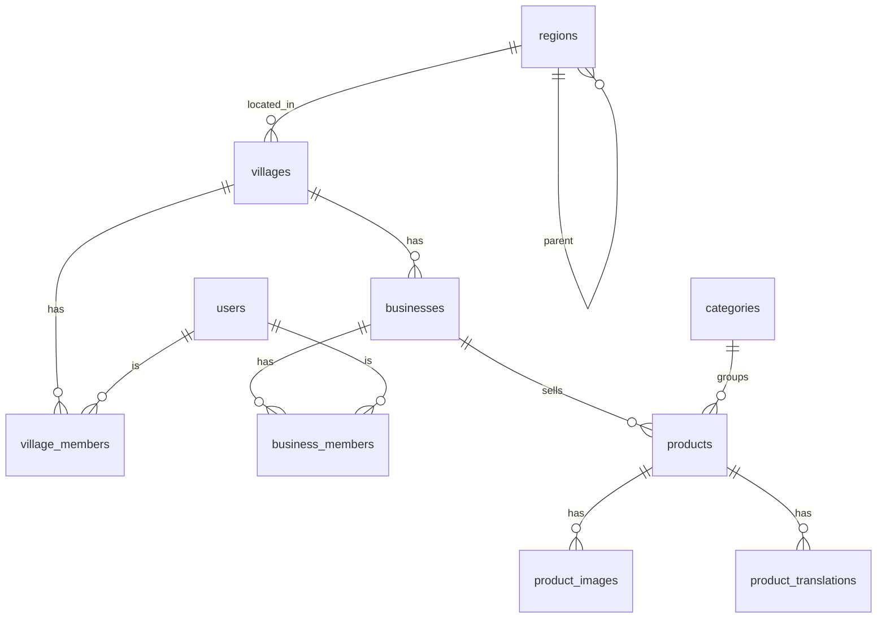

# Data model

Source of truth: `packages/db/src/schema/*`. Migrations: `packages/db/drizzle/`. This page explains intent.

## Conventions

- Ids: `uuid` (random) for domain tables; Better Auth tables use text ids.
- `createdAt` / `updatedAt` everywhere; `deletedAt` (soft delete) on villages, businesses, products.
- `isSeed` on rows created by the demo seed; `db:seed:reset` deletes only those.
- Money: `products.price` is an integer in rupiah. `0` means free ("Gratis"); otherwise at least Rp100
  (validator, catches typos). `products.compareAtPrice` (nullable) is the normal price shown struck through
  for a discount or a free promo; a check constraint keeps it above `price`, and a non-negative check guards
  `price`. There is no separate `is_free` column (one source of truth); the API derives `isFree`.
- Product slugs are generated from the name by the API, unique platform-wide; a taken name gets the business
  name appended, then `-2`, `-3` … (`keripik-singkong` → `keripik-singkong-keripik-bu-ani`). The village of a
  product is always its business's village. Variants (size, flavour) are separate products in the MVP.
- No unit field (decided 2026-11-16): like marketplace titles, size and packaging are part of the product name
  ("Keripik Singkong Balado 250 gr"). `products.unit` is deprecated: migration `0005_product_unit_into_name`
  appended any stored value to the name and emptied the column; nothing reads or writes it, and a later
  migration drops it (two-step removal).
- Status: `record_status` = draft | published | archived. Businesses also have
  `verification_status` = pending | verified | rejected (verified once by the village admin).
- `businesses.consentAt` records UU PDP consent; required before publishing. `consentMethod`
  (`paper_form` | `in_app`) and `consentRecordedBy` say how it was obtained and by whom, so consent can be
  proven later. Staff record `paper_form` from the signed form; the owner confirms `in_app` at hand-over.
- `businesses.verificationNote` holds the reason of the last review decision.
- `businesses.takenDownAt` / `takenDownBy` / `takedownReason`: a village admin's takedown. Public queries
  exclude taken-down businesses (`publicBusiness` in `apps/api/src/lib/visibility.ts`).
- Business slugs are generated from the name by the API (`toSlug()` in `@repo/validators`, `-2`, `-3` … on
  duplicates) and only village admins may change them (it breaks shared links).
- `villages.theme` / `theme_draft` (JSONB) hold per-village branding; shape and rules in
- `businesses.openingHours` (JSONB, `OpeningHours` in `@repo/validators`), `closedUntil`, `closedNote` drive the
  open/closed status, computed with `computeOpenStatus()` in the village time zone (`villages.timezone`,
  default `Asia/Jakarta`). No schedule = no status shown.
  [village-theming.md](village-theming.md). Always read with `parseVillageTheme()`.
- Translations: Indonesian is the base column; optional rows in `*_translations` (`locale = 'en'`) override it.
  Read with a fallback to the base column.

## Regions

`regions.code` uses Kemendagri codes: `32` (province), `32.04` (regency/city), `32.04.16` (district),
`32.04.16.2005` (village). All 91,599 regions of Kepmendagri 2025 are loaded from
`packages/db/data/regions` by `bun run db:regions:import` (also run by `db:seed`); source, version and licence
are in `packages/db/data/regions/SOURCE.md`. Codes are never invented by hand.

- The code is the key and encodes the hierarchy, so "everything in Kabupaten Bandung" is
  `code LIKE '32.04.%'` (btree index with `text_pattern_ops`); no recursive joins.
- `fullName` ("Baros, Kec. Arjasari, Kabupaten Bandung, Jawa Barat") is built at import and searched through a
  `pg_trgm` GIN index on `lower(full_name)`. Every search word must match (`GET /v1/regions/search`).
- `lat`/`lng`: the region's centre point (WGS84) from the open boundaries dataset; 91,439 rows have one.
- Rows are never deleted. When a newer dataset drops a code (regions split or merged), the import sets
  `retiredAt`; villages and businesses that point at it stay valid and searches hide it. `sourceVersion` records
  the dataset version that last wrote each row, so a repeated import is skipped.
- Size: about 37 MB with indexes. Clients never load the whole table: search returns at most 20 rows and a
  children list one level, both cached (`s-maxage` one day).

`villages.regionCode` should be the village-level code (the seeded Desa Baros is `32.04.16.2005`; the fictional
demo villages point at a regency). A unique partial index allows one live tenant per region code, so a desa cannot
be registered twice. `villages.centerLat`/`centerLng` hold the map centre the village admin chose; null means the
region's centre point.

## Personal data on public pages

`businesses.address` (and the RT/RW and map pin planned next) is often the owner's home. Public API responses and
pages never include it: a business's public location stops at its village and the village's region, the way
marketplaces show only the seller's city. These fields exist for the village team in the dashboard.

## Planned (not in the schema yet)

- Search: `pg_trgm` + `unaccent` indexes on product/business names (migration with the search feature).
- Payments (phase 3): `orders`, `order_items`, `payments` with idempotency keys and webhook log.
