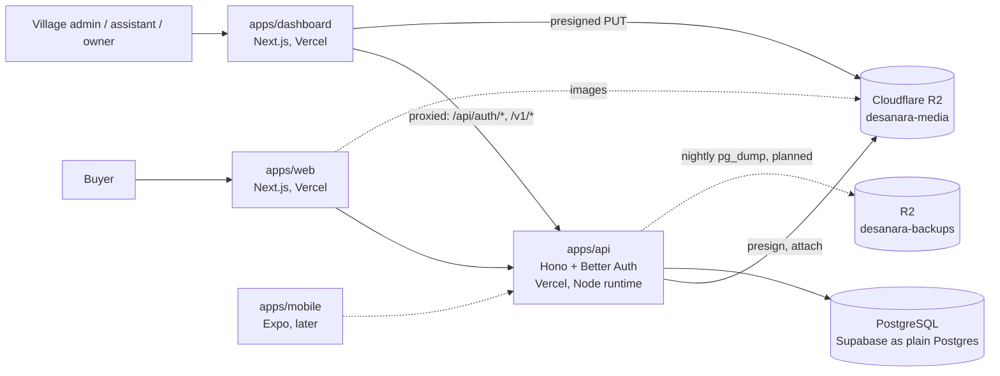

# Architecture overview

## System



- Frontends never access the database. All reads and writes go through the API (`@repo/api-client`).
- `apps/web` renders public pages on the server (SEO, link previews in WhatsApp) and caches with ISR.
- `apps/dashboard` is client-heavy (TanStack Query) and talks to the API with the session cookie.
- All three apps run on Vercel (`sin1`); the API can also run on a VPS with Docker as a fallback (ADR 0009).
- Hosts: `desanara.app` (web), `dashboard.desanara.app`, `api.desanara.app`, media on `cdn.desanara.app`. The
  dashboard proxies `/api/auth/*` and `/v1/*` to the API so the session cookie stays first-party
  ([deployment](deployment.md)). Mobile will use bearer tokens.

## Layers inside the API

```text
routes      HTTP + OpenAPI contract (zod-openapi). Validates input, calls a service. No SQL.
service     Business rules + authorization (assertCan). Writes audit logs. No HTTP objects.
repository  Drizzle queries only. Always tenant-scoped and soft-delete aware.
```

`createApp({ db, auth, storage })` in `apps/api/src/app.ts` wires middleware (request id, logging, secure headers,
CORS, session → actor) and mounts each module. Dependencies are injected so tests can build the app
without a real database (`apps/api/src/app.test.ts`).

## Shared vs local code

| Question                                 | Put it in                          |
| ---------------------------------------- | ---------------------------------- |
| Validation used by API and a form        | `packages/validators`              |
| Who may do what                          | `packages/auth/src/permissions.ts` |
| Table definitions, migrations, seed      | `packages/db`                      |
| Neutral UI primitive or theme token      | `packages/ui`                      |
| Formatting money/dates, locale list      | `packages/i18n`                    |
| A page, a role-specific form, navigation | the app that owns it               |

## Data flow examples

```text
Server Component (web)  → api.v1.villages.$get() → GET /v1/villages → service → repository → Postgres
Client Component (dash) → useQuery(['me'])       → GET /v1/me (cookie) → session middleware → actor
                                                    (+ memberships: village/business names for the shell)
Photo upload (dash)     → compress in browser → POST /v1/manage/media/presign (assertCan, limits)
                          → browser PUT to R2 (signed type + size) → POST /v1/manage/media (attach key)
```

## API modules

| Module                                         | Paths                                                                                                                    | Who                                      |
| ---------------------------------------------- | ------------------------------------------------------------------------------------------------------------------------ | ---------------------------------------- |
| `health`                                       | `/health`, `/health/ready`                                                                                               | public                                   |
| `villages`, `regions`, `businesses`, `catalog` | `/v1/villages`, `/v1/regions` (search, children, one), `/v1/businesses`, `/v1/products`, `/v1/categories`, `/v1/sitemap` | public, cached, published rows only      |
| `events`                                       | `POST /v1/events`                                                                                                        | public, view and WhatsApp click tracking |
| `me`                                           | `/v1/me`                                                                                                                 | logged in: actor + memberships           |
| `manage-businesses`                            | `/v1/manage/businesses…` (list, create, edit, verify, publish, takedown, delete)                                         | logged in, `can()`                       |
| `manage-villages`                              | `/v1/manage/villages/{id}` (read: `village.view`, edit profile and map centre: `village.update`)                         | logged in, `can()`                       |
| `manage-products`                              | `/v1/manage/businesses/{id}/products`, `/v1/manage/products/{id}…`                                                       | logged in, `can()`                       |
| `media`                                        | `/v1/manage/media/presign`, `/v1/manage/media`                                                                           | logged in, `can()`                       |

The live reference with every request and response schema is `/docs` (Scalar, generated from the routes).

## Related

- [Structure](structure.md) · [Multi-tenancy](multi-tenancy.md) · [Auth & RBAC](auth-rbac.md)
- [Data model](data-model.md) · [API conventions](api-conventions.md) · [i18n](i18n.md)
- [Security & privacy](security-privacy.md) · [Storage](storage.md) · [Deployment](deployment.md) · [ADRs](../adr/README.md)
