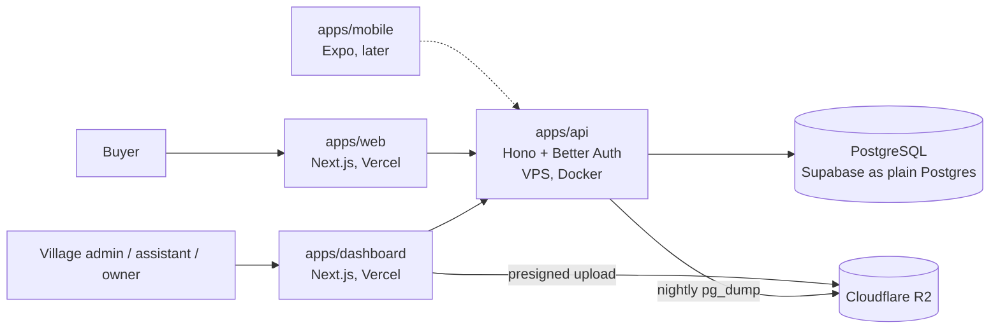

# Architecture overview

## System



- Frontends never access the database. All reads and writes go through the API (`@repo/api-client`).
- `apps/web` renders public pages on the server (SEO, link previews in WhatsApp) and caches with ISR.
- `apps/dashboard` is client-heavy (TanStack Query) and talks to the API with the session cookie.
- Production domains share one parent so the Better Auth cookie works everywhere:
  `<domain>` (web), `dashboard.<domain>`, `api.<domain>`. Mobile uses bearer tokens.

## Layers inside the API

```text
routes      HTTP + OpenAPI contract (zod-openapi). Validates input, calls a service. No SQL.
service     Business rules + authorization (assertCan). Writes audit logs. No HTTP objects.
repository  Drizzle queries only. Always tenant-scoped and soft-delete aware.
```

`createApp({ db, auth })` in `apps/api/src/app.ts` wires middleware (request id, logging, secure headers,
CORS, session → actor) and mounts each module. Dependencies are injected so tests can build the app
without a real database (`apps/api/src/app.test.ts`).

## Shared vs local code

| Question                                 | Put it in                          |
| ---------------------------------------- | ---------------------------------- |
| Validation used by API and a form        | `packages/validators`              |
| Who may do what                          | `packages/auth/src/permissions.ts` |
| Table definitions, migrations, seed      | `packages/db`                      |
| Neutral UI primitive or theme token      | `packages/ui`                      |
| Formatting money/dates, locale list      | `packages/i18n`                    |
| A page, a role-specific form, navigation | the app that owns it               |

## Data flow examples

```text
Server Component (web)  → api.v1.villages.$get() → GET /v1/villages → service → repository → Postgres
Client Component (dash) → useQuery(['me'])       → GET /v1/me (cookie) → session middleware → actor
                                                    (+ memberships: village/business names for the shell)
Photo upload (planned)  → POST /v1/uploads (presign, assertCan) → browser PUT to R2 → save storageKey
```

## Related

- [Structure](structure.md) · [Multi-tenancy](multi-tenancy.md) · [Auth & RBAC](auth-rbac.md)
- [Data model](data-model.md) · [API conventions](api-conventions.md) · [i18n](i18n.md)
- [Storage](storage.md) · [Deployment](deployment.md) · [ADRs](../adr/README.md)
