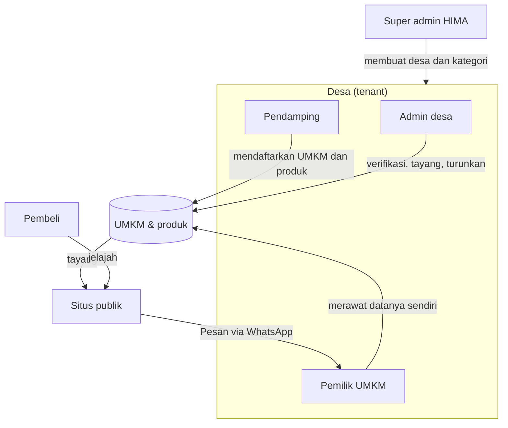
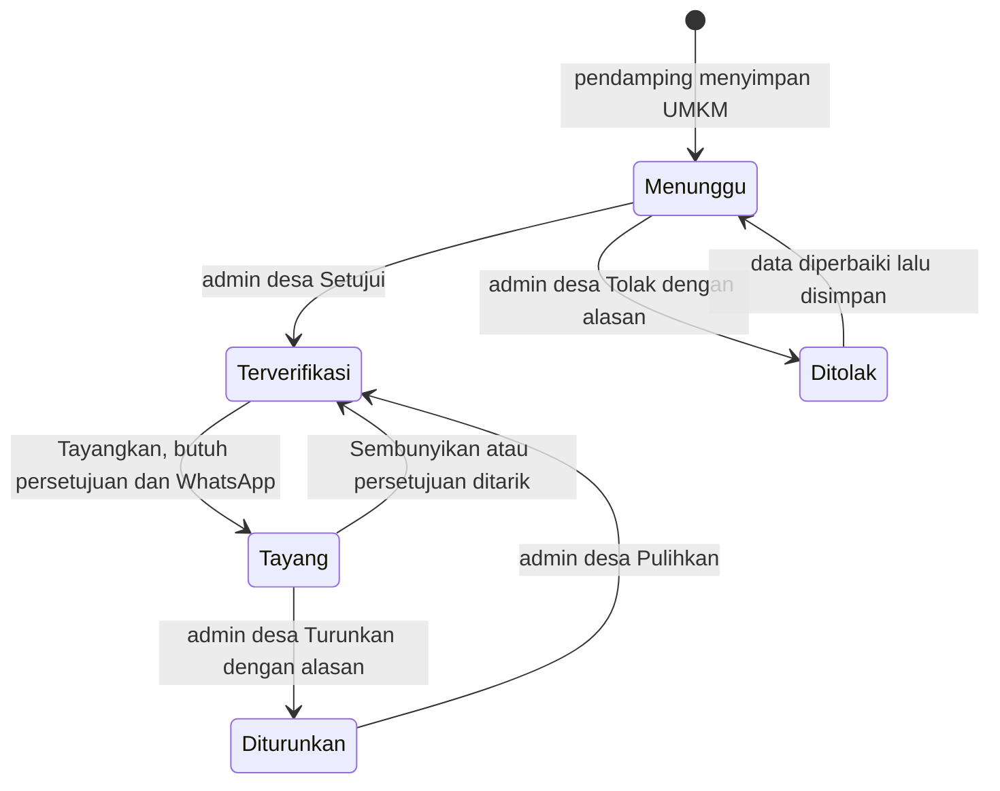

# Alur pengguna

Dokumen ini menjelaskan cara Desanara dipakai oleh setiap peran, tanpa perlu membaca kode.
Istilah teknis ada di [glosarium](glossary.md). Panduan langkah demi langkah di dashboard: [panduan dashboard](../guides/dashboard-user-guide.md).

Bagian bertanda **(belum tersedia)** direncanakan selesai sebelum feature freeze 28 November 2026.

## Gambaran besar

Setiap UMKM dan produk **milik satu desa**. Admin desa hanya bisa mengelola UMKM di desanya sendiri.
Pendamping dan pemilik hanya bisa mengelola UMKM tempat mereka terdaftar.

## 1. Pembeli

Pembeli tidak perlu akun.

1. Membuka link dari WhatsApp/media sosial, atau mencari di Google.
2. Menjelajah lewat **beranda**, **Jelajah** (pencarian, filter wilayah dan kategori, urutan), atau langsung ke **halaman desa**.
3. Halaman desa menampilkan cerita desa, tampilannya bertema sesuai desa (warna, logo, huruf), dan daftar UMKM-nya.
4. Halaman UMKM menampilkan cerita usaha, status **buka/tutup** (dihitung dari jam buka), link toko online, dan produknya.
5. Halaman produk menampilkan foto (bisa digeser), harga (atau **Gratis**, atau harga coret saat promo), dan ukuran atau isi yang tertulis di nama produk (misalnya "Keripik Singkong Balado 250 gr").
6. Pembeli mengatur **jumlah** dan **catatan**, lalu menekan **Pesan via WhatsApp**. WhatsApp terbuka dengan pesan yang sudah terisi.
   Pembayaran dan pengiriman disepakati langsung dengan penjual.

Yang **tidak** pernah tampil ke pembeli: alamat jalan, RT/RW, dan titik peta UMKM. Lokasi publik berhenti di tingkat desa.

Situs tersedia dalam Bahasa Indonesia (`/`) dan Inggris (`/en`). Teks produk berbahasa Inggris tampil bila UMKM mengisinya.

## 2. Pendamping (mahasiswa atau peserta KKN)

Pendamping desa boleh mendaftarkan UMKM baru di desanya. Setelah mendaftarkan, ia otomatis menjadi pendamping UMKM tersebut.

1. **Masuk** ke dashboard, buka menu **UMKM**, lalu tekan **Tambah UMKM**.
2. Isi form 3 langkah:
   - **Data usaha**: desa, nama usaha, nama pemilik, cerita singkat, alamat (hanya untuk tim desa), NIB (opsional).
   - **Kontak dan toko online**: nomor WhatsApp (wajib sebelum tayang), link Shopee/Tokopedia/TikTok Shop/Instagram.
   - **Persetujuan pemilik**: bacakan teks persetujuan ke pemilik, minta tanda tangan formulir kertas, lalu centang.
3. Isian tersimpan otomatis di HP. Kalau sinyal putus atau aplikasi tertutup, isian bisa dilanjutkan.
4. Setelah disimpan, UMKM berstatus **Draf** dan **Menunggu verifikasi**.
5. Bila ditolak admin desa, alasannya tampil di halaman UMKM. Perbaiki datanya. Setelah disimpan, UMKM otomatis kembali menunggu verifikasi.
6. Setelah terverifikasi, pendamping bisa menekan **Tayangkan**.
7. Menambah produk dari halaman UMKM: foto (sampai 10, foto pertama jadi sampul), nama beserta ukurannya, kategori,
   harga atau Gratis, harga coret saat promo, dan deskripsi. Produk tersimpan sebagai draf, lalu bisa ditayangkan.
8. Menyerahkan akun ke pemilik lewat link undangan WhatsApp (belum tersedia).

## 3. Admin desa

1. **Masuk**, lalu buka menu **UMKM**. Tab **Perlu dicek** berisi UMKM yang menunggu verifikasi.
2. Buka satu UMKM dan periksa bahwa usaha itu benar ada di desa dan datanya sesuai.
3. Tekan **Setujui**, atau **Tolak** dengan alasan (dibaca pendamping).
4. Halaman UMKM menampilkan **syarat tayang** sebagai daftar centang: terverifikasi, ada persetujuan pemilik, ada nomor WhatsApp, tidak sedang diturunkan.
5. **Turunkan** menyembunyikan UMKM dari publik dan mencatat alasannya, misalnya karena ada laporan warga. Selama diturunkan, UMKM tidak bisa ditayangkan.
   **Pulihkan** mencabut penurunan. UMKM kembali ke draf dan perlu ditayangkan lagi.
6. (belum tersedia) Pengaturan desa: titik tengah desa di peta, logo dan banner, warna tema, anggota tim desa.
7. (belum tersedia) Statistik: jumlah kunjungan dan klik WhatsApp per UMKM, untuk laporan dampak.

## 4. Pemilik UMKM

Pemilik bisa masuk dengan akun yang dibuatkan pengurus dan melihat UMKM-nya.
Yang direncanakan:

- Menerima **link undangan** lewat WhatsApp dari pendamping, membuat kata sandi, lalu menjadi pemilik.
- **Mendaftar sendiri** lewat link/QR desa (`/gabung/<desa>`) atau form terbuka. Akun baru dibuat setelah admin desa menyetujui pendaftaran.
- Mengubah data usaha, produk, foto, dan jam buka sendiri. Pendamping tetap bisa membantu sampai pemilik mencabut aksesnya.
- Menarik persetujuan publikasi kapan saja. UMKM langsung disembunyikan.

## 5. Super admin (pengurus HIMA)

- Melihat semua UMKM di semua desa dari dashboard.
- (belum tersedia) Membuat dan mengaktifkan desa baru. Desa mengajukan diri lewat form **Ajukan desa**, tim HIMA memverifikasi (telepon, kunjungan, MoU), lalu super admin mengaktifkan.
- (belum tersedia) Mengelola kategori dan pengguna.

## Status UMKM

Sebuah UMKM punya tiga sisi status yang berjalan bersamaan:

| Sisi       | Nilai                            | Artinya                                             |
| ---------- | -------------------------------- | --------------------------------------------------- |
| Verifikasi | Menunggu, Terverifikasi, Ditolak | Sudah dicek admin desa atau belum. Cukup sekali.    |
| Tayang     | Draf, Tayang                     | Tampil di situs publik atau tidak.                  |
| Penurunan  | Normal, Diturunkan               | Disembunyikan paksa oleh admin desa, dengan alasan. |

Syarat **tayang**: terverifikasi, ada persetujuan pemilik, ada nomor WhatsApp, dan tidak sedang diturunkan.
Bila satu syarat belum terpenuhi, dashboard menjelaskan apa yang kurang.

## Status produk

- Produk bisa **Draf** atau **Tayang**.
- Syarat tayang: punya kategori dan minimal 1 foto (maksimal 10). Foto terakhir produk yang sedang tayang tidak bisa dihapus.
- Tidak ada isian satuan. Seperti judul di marketplace, ukuran atau isi ditulis di nama produk, dan ukuran lain dibuat sebagai produk terpisah.
- **Stok kosong**: produk tetap tampil tetapi tidak bisa dipesan.
- Produk hanya tampil bila UMKM-nya juga sedang tayang.
- Harga dalam rupiah bulat: `0` berarti **Gratis**, selain itu minimal Rp100. Harga coret (harga normal) harus lebih tinggi dari harga jual. Badge diskon dihitung otomatis.
- Tidak ada "turunkan produk". Admin desa bisa menghapus produk yang bermasalah, dan penghapusannya tercatat di jejak audit.

## Data pribadi

| Data                                                                       | Siapa yang melihat                                        |
| -------------------------------------------------------------------------- | --------------------------------------------------------- |
| Nama usaha, nama pemilik, cerita, produk, nomor WhatsApp, link toko online | Publik (setelah ada persetujuan)                          |
| Desa, kecamatan, kabupaten                                                 | Publik                                                    |
| Alamat jalan, RT/RW, titik peta                                            | Hanya tim desa dan pendamping UMKM tersebut               |
| NIB                                                                        | Hanya tim desa dan pendamping UMKM tersebut               |
| Email dan kata sandi akun                                                  | Hanya pemilik akun; kata sandi disimpan dalam bentuk hash |

Detail teknis: [keamanan & privasi](../architecture/security-privacy.md).
